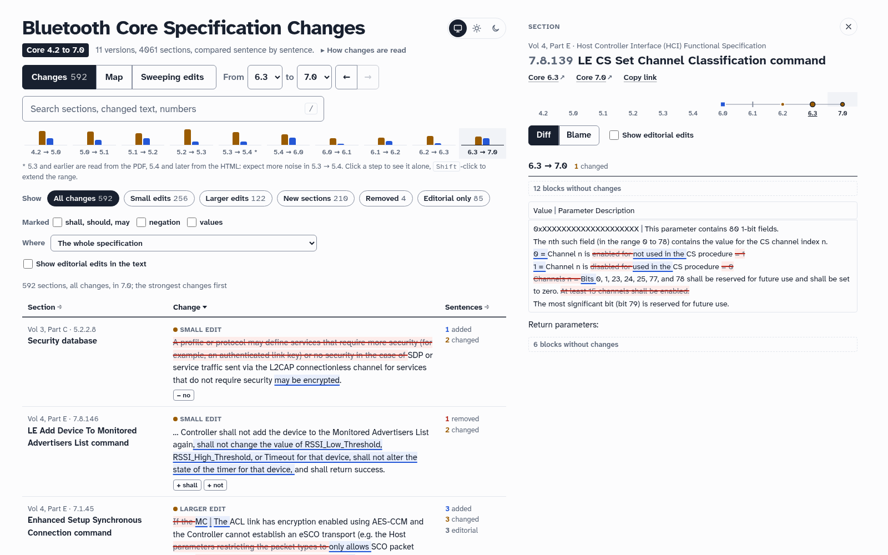
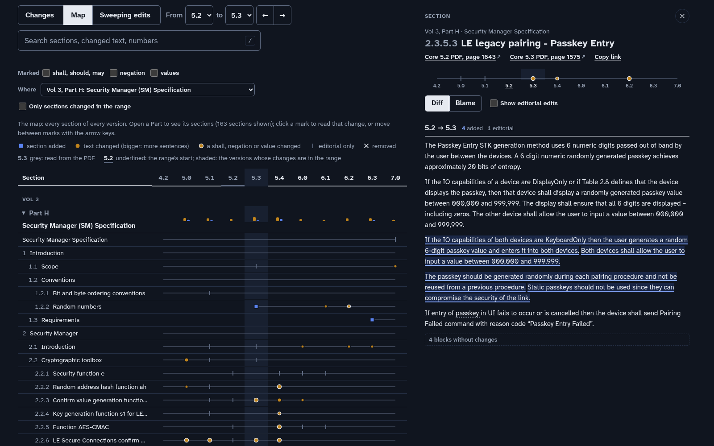
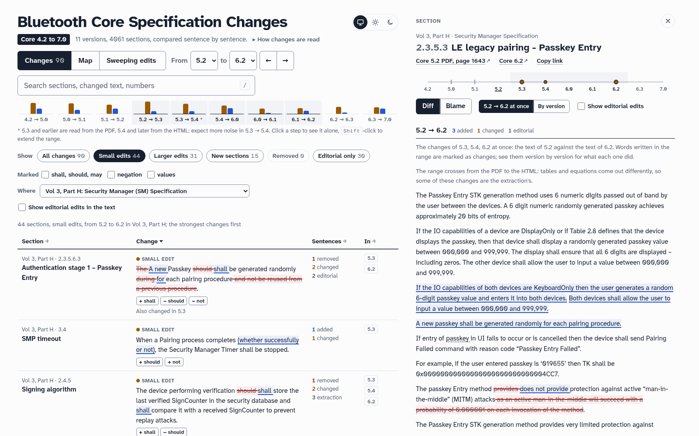
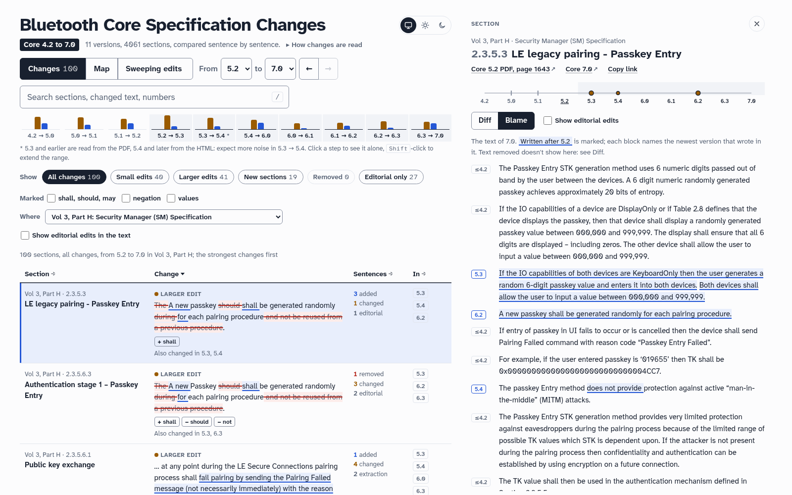

# Seeing what changed in the Bluetooth Core Specification

A concept for diffing Core versions so that both kinds of change show: the big ones (a
new protocol, a new Part) and the small ones (one sentence added to a section that has
been there since 4.2). It comes with a working prototype that covers Core 4.2 to 7.0. See
the [README](README.md) to run it.

## The problem

A plain diff of two Core versions is unreadable, and the small changes are the first
thing it loses:

- **Volume.** Each version has about 3,000 pages. 5.3 changed text in 1,274 sections.
- **Sweeping rewrites.** 5.3 replaced *slave* with *peripheral* 1,259 times (in 372
  sections) and *master* with *central* 1,192 times. 5.1 renamed every command in prose
  ("a Command Complete" → "an HCI_Command_Complete"), and 6.1 began each command's
  description with "This command" instead of its name. These touch hundreds of sections and
  change nothing.
- **Renumbering.** A section added early in a Part renumbers every reference after it
  ("see Figure 2.80" → "Figure 2.90").
- **Format.** 5.3 and older are published as PDF, 5.4 and later as HTML. Tables, code and
  equations come out differently.
- **Structure.** Sections move and get retitled, and whole Parts move (the HCI went from
  Vol 2, Part E to Vol 4, Part E in 5.2). Paragraphs get split and merged.

Against that background, the static-passkey sentence the change was remembered by is a
single sentence in a section that otherwise stayed the same.

## The idea

**Compare the spec in the unit a reader thinks in, the sentence. Factor out what is
editorial. Then show what remains three ways: a ranked list of changes, a map of the whole
spec over time, and the history of one section.**

### 1. Sentences, followed through time

- Each version is split into **sections** (Vol, Part, number, title) and each section
  into **sentences**. A table row, a code line and a figure title count as one sentence
  each; where the HTML has several paragraphs in a table cell, the row is compared line
  by line.
- Every section gets a **lineage**: one id for its whole life, however it is
  renumbered, retitled or moved. HTML ids are stable from 5.4 on. Elsewhere sections are
  matched by number and title, then by title, then by number with similar text or a close
  title, then by text alone, and last by text in any other Part (7.0 moved the notation of
  the message sequence charts into Vol 1, Part E). A section whose title only changed by
  one of the step's sweeping edits ("… by Slave" becoming "… by Peripheral") keeps its
  lineage, and so does one that becomes "[This section is no longer used]".
- Within a section, sentences are aligned to their old selves; so are sentences, which
  get an id of their own for their whole life. A changed sentence is diffed word by word,
  on its words regardless of case and punctuation. A sentence that moved within its
  section and was reworded is paired with where it came from: 6.3 moved HCI error
  conditions from prose into tables, and each new row shows as a diff against the sentence
  it replaced. A sentence rewritten where it stands is simply a changed sentence.
- **Blame.** Every word of every version knows the version that wrote it. An editorial
  edit keeps the old origin, so "master → central" doesn't make a sentence new.

### 2. Editorial or not

Each word-level edit is classified. These classes are editorial and hidden by default
(one click shows them):

| Class | Example |
|---|---|
| format | `Passkey` → `passkey`, `canceled` → `cancelled`, `3-8` → `3 to 8`, `follows:` → `follows.`, `11b` → `0b11` |
| naming | `LE Set Scan Enable` → `HCI_LE_Set_Scan_Enable`, `a Mode Change` → `an HCI_Mode_Change` |
| reference | `Section 2.3.5` → `Section 2.3.6`, `Sections 2.3 and 2.4` → `Sections 2.3 and 2.5`, `C204` → `C.202` |
| sweeping | `master` → `central`: a replacement made in ≥ 6 places in ≥ 4 sections of one version step; `The HCI_Reset command` → `This`, the same rewrite of ≥ 2 identifiers (≥ 20 in one section). **Learnt from the data**, never from a hand-kept list. |
| moved | the same sentence removed in one place and added in another |
| extraction | only where the format changes (5.3 → 5.4): scraps of equations and figures, and scraps of tables whose words are on the other side too |

A sweeping edit never adds, removes or swaps *shall*, *should*, *may*, a negation, a value
or a word that narrows or widens a sentence (*only*, *all*, *lower*, *insufficient*, …),
and it only adds or removes words that mean nothing on their own (*the*, *of*), or the
words of a Part's new title where a reference quotes it ("[Vol 1] Part F, Controller Error
Codes" in 5.2). Everything it sets aside stays one click away: the Sweeping edits view
lists where each one applied, and any of them can be counted as a change instead.

Text the PDF adds and the HTML doesn't is dropped before comparing: page numbers of
references ("on page 1333") and the sheet count of tables set over several pages.

Everything else is a **change**. Changes carry **signals**, which drive the ranking:

- a normative word added, removed or swapped: *shall*, *should*, *may*, *must*,
  *required*, *optional*, *mandatory*, …
- a negation: *not*, *no*, *never*, … ("disabled" becoming "not used" rewords one)
- a value: a number, hex value or unit, but not a section, table, figure or page number,
  a list item's number, or the same number written another way

Normative words and negations drive the ranking: an edit to a sentence that stays comes
first, then a sentence added or removed whole, then the sentences of new sections, which
are easy to find anyway. Values are marked but don't rank.

A **small edit** changes at most three sentences of a section that already existed. That
is the category for "they added one sentence to an old section". Each version has between
177 and 649 small edits, and 16–110 of them touch a *shall*, *should* or *may*. Over a
range of versions each sentence counts once, as it differs between the two ends.

### 3. Three views, one panel

The prototype keeps the look and the interaction model of the HCI reference page
(`hci-page`): the same type, colours and light and dark themes. The search and switches
stay in a sticky bar, there are chips for filters and a table with a panel beside it, and
everything is in the URL.

**Changes**: what changed between two versions, as a ranked list. You pick a version
range (a rail shows how much each step changed). The list shows each section once, with
its strongest change as an excerpt (a new section: its first sentence): removed text
struck through in red, added text underlined in blue. Filters are *Small edits*, *Larger
edits*, *New sections*, *Removed* and *Editorial only*, plus "marked" (normative,
negation, values: any of those ticked) and a Part. The search covers headings and all the
changed text, and section numbers ("7.8.13" finds 7.8.13 and 7.8.13.1). The default sort
puts the strongest single change first, not the biggest rewrite, so that a "should"
becoming "shall" isn't buried under a 40-sentence rewrite. Over several versions the tags
are net: *should* added in 5.3 and made *shall* in 6.2 is "+ shall".

**Map**: every section of every version. Each Part is a row of bars per version (sections
changed, sections added). Opened, it shows a row per section: a line from the version that
added the section to the last that has it. On that line:

- a **blue square** where it was added
- an **amber dot** where its text changed, bigger for more sentences and ringed when a
  shall, negation or value changed
- a **grey tick** for editorial edits
- an **ink ×** where it was removed

A quiet change looks like what it is: one dot on a long, otherwise empty line. Click a
mark to read that change, or move between marks with the arrow keys. The shaded band marks
the versions whose changes are in the range; the range's first version, the one compared
against, is underlined. The Part bars share one scale, and the map can show only the
sections changed in the range.

**Sweeping edits**: the replacements each version made everywhere, with counts. This
shows what was set aside as editorial and why: each one lists the sections it applied to,
and can be unticked to count it as a change, everywhere on the page. It is a changelog of
terminology in its own right: 5.3's master/slave and white list, 5.1's HCI names, 6.0's
DUT → IUT, 6.1's "This command".

**The section panel** opens beside the list (under the row on narrow screens):

- a **life strip** for this section across all versions, using the map's marks
- **Diff**: for a range of several versions, the whole range at once (the text of its
  first version against its last, composed from each step's alignment), or each step in
  turn; unchanged paragraphs are folded away
- **Blame**: the text of the chosen version. Words written after the start of the range
  are marked, and each paragraph names the newest version that wrote in it.

## The passkey example, as the tool shows it

The prototype recovers this history of passkey entry in Vol 3, Part H (it is checked in
`tests/test_data.py`):

| Version | Section | Change |
|---|---|---|
| 5.1 | 2.3.5.6.3 Authentication stage 1 – Passkey Entry (LE Secure Connections), and Vol 2, Part H | adds "The Passkey should be generated randomly during each pairing procedure and not be reused … Static Passkeys should not be used since they can compromise the security of the link." |
| 5.3 | 2.3.5.3 LE legacy pairing – Passkey Entry | adds the same advice, and the KeyboardOnly paragraph |
| 5.4 | 2.3.5.3 | "The passkey Entry method ~~provides~~ **does not provide** protection against active MITM attacks", and drops the 0.000001 probability claim (marked: negation, value) |
| 6.2 | 2.3.5.3 and 2.3.5.6.3 | "~~The~~ **A new** passkey ~~should~~ **shall** be generated randomly ~~during~~ **for** each pairing procedure", and the static-passkey sentence goes (marked: normative) |

So the change remembered as "static passkeys in LESC, 5.3" was:

- added for LE Secure Connections in 5.1
- carried over to LE legacy pairing in 5.3
- made normative in 6.2

That is the kind of answer the blame view gives directly.

Small edits of the same kind, found the same way:

- **7.0** drops "~~At least 15 channels shall be enabled.~~" from the CS channel map of
  HCI_LE_CS_Set_Channel_Classification (and rewrites how the bits are described; see
  Limits for how that rewrite once misled this page).
- **5.3** adds "**and shall not be greater than the peer device's MTU for the channel**"
  to the L2CAP SDU Length field.
- **6.3**: when HCI errors move into tables, the condition for one error changes from
  "not configured for periodic advertising **or** configured for PAwR" to "not configured
  for (PA or PAwR)".

## Limits, and where it could go

- **The format boundary.** 5.3 → 5.4 compares PDF with HTML. Prose comes through well;
  tables with merged cells, equations and sample data less so. The step is flagged in the
  rail and in the panel, and wordless scraps are set aside. Expect more noise there than
  anywhere else.
- **Figures** are images in the HTML and are compared only by their titles.
- **Sweeping edits** are a judgment by frequency. A real change made in many places at
  once is treated as editorial: 7.0's *access address* → *PCA Group* in the PCA sections
  is one. The Sweeping edits view lists every one of them and where it applied, and any of
  them can be counted as a change, so nothing is hidden silently.
- **Word diffs keep the order of the text.** 7.0 rewrote the CS channel map's "Channel n
  is enabled for CS procedure = 1 / Channel n is disabled for CS procedure = 0" as
  "0 = Channel n is not used in the CS procedure / 1 = Channel n is used in the CS
  procedure": the same bits, described the other way round and in the other order. The
  diff pairs each line with the one in its place, so it reads as *enabled* becoming *not
  used*; both sides are on screen, and they say the same. An earlier version of this page
  diffed the whole table cell as one run of words, and its excerpt read as if 7.0 had
  inverted the bits. It hadn't; that claim stood in this document until it was checked
  against the specification.
- **Sentences that move between sections** are recognised when unchanged. If they are
  also reworded, they show as removed in one place and added in the other.
- **Older versions.** 4.0, 4.1 and the Core Specification Addenda and errata service
  releases are PDF and could be added the same way. The SIG also publishes a redline
  ("Changes since previous version") for each release. It could be used to check this
  tool's results.
- **Next steps:**
  - link the HCI reference page's commands and events to their history here
  - a "what's new in X.Y" export
  - per-feature tags (a change belongs to Channel Sounding or to PAwR)
  - full-text search over all versions
  - an optional LLM pass that summarises each small edit in one line, the way
    `summaries.toml` does for hci-page, but checked against the diff
